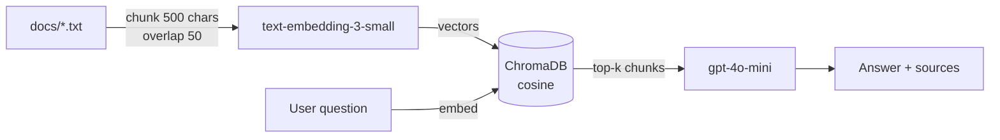
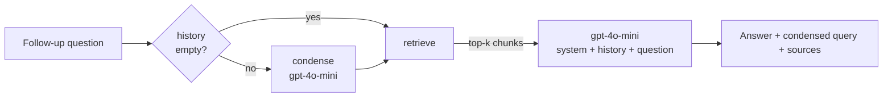

# Simple RAG Demo

A minimal Retrieval-Augmented Generation application built with FastAPI, ChromaDB, and the OpenAI API. Ask a question about your own text documents and get an answer grounded in them, along with the source chunks and their similarity scores.

It ships two interfaces over the same index: a single-shot search page (`/`) and a chat page (`/chat`) that carries conversation history, so follow-up questions like "can I increase it?" resolve against what was just discussed.

The project is deliberately small — roughly 320 lines of Python across five files — so the whole retrieval pipeline stays readable end to end. No LangChain, no LlamaIndex; every call to ChromaDB and the OpenAI API is written out.

## How it works



Ingestion and querying both embed text with the same model, `text-embedding-3-small`. ChromaDB stores the vectors and performs nearest-neighbour search; it never generates embeddings itself, since they are passed in explicitly. The retrieved chunks are inserted into a prompt that instructs the model to answer only from the supplied context, and to say so when the context does not cover the question.

Each single-shot query costs two API calls: one embedding of the question, one chat completion.

## Conversational mode

Vector search has no memory. Embedding the literal question "can I increase it?" retrieves whatever happens to be near the word "increase" — the pronoun carries the actual subject, and the index cannot see it. `/chat` therefore runs a two-stage pipeline:



**Condense** rewrites the question into a standalone search query using the conversation history, then **retrieval and generation** proceed as before, with the history included in the messages array. On the sample document the effect is measurable: "それは追加できますか？" condenses to "1ユーザーあたりの標準保存容量50GBは追加できますか？", and the top chunk's similarity rises from 0.390 to 0.459.

The first turn of a session skips the condense call entirely — with no history there is nothing to resolve, so spending an API call on it would be waste. Subsequent turns cost three calls: condense, embed, answer.

History lives in memory, keyed by session ID, capped at the last six exchanges. That is enough for a demo and deliberately not durable; a production deployment would swap `ConversationMemory` for Redis. Restarting the server — including any reload triggered by `--reload` — drops every session.

The chat UI surfaces all of this: each answer is annotated with the condensed query that was actually searched, the retrieved chunks with their scores, and the current turn count.

## Requirements

- Python 3.9 or later
- An OpenAI API key with available credit

Verified on macOS with Python 3.9.12 and chromadb 1.5.9. All dependencies install from prebuilt wheels — no compiler toolchain required.

## Setup

```bash
python3 -m venv .venv
.venv/bin/pip install -r requirements.txt

cp .env.example .env
# then open .env and paste your key after OPENAI_API_KEY=
```

## Usage

Run the ingestion step first, then start the server:

```bash
.venv/bin/python ingest.py
.venv/bin/uvicorn api:app --reload
```

Open http://127.0.0.1:8000 for single-shot search, or http://127.0.0.1:8000/chat for the conversational UI.

Drop `--reload` when trying the chat page. Every file save restarts the process and clears the in-memory conversation history, which silently turns a follow-up question into a first turn.

`ingest.py` reads every `.txt` file in `docs/` and prints how many chunks each one produced, followed by the total vector count. A total of `0` means no documents were found — check that `docs/` contains `.txt` files.

To add your own documents, drop them into `docs/` and run `ingest.py` again. It uses `upsert`, so re-running will not create duplicates.

### Order matters

Run `ingest.py` before starting the server the first time. Both modules call `get_or_create_collection`, and whichever runs first determines the collection's distance metric. Both now request cosine explicitly, so the order is no longer load-bearing, but ingesting first is still the sensible sequence — otherwise the server starts against an empty index and every answer will be "資料に記載がありません".

Both modules also resolve `./chroma_db` and `templates/` relative to the working directory, so run all commands from the project root.

## API

`POST /query`

```json
{ "query": "What is the storage limit?", "top_k": 4 }
```

Response:

```json
{
  "answer": "...",
  "sources": [
    { "text": "...", "source": "docs/sample.txt", "score": 0.393 }
  ]
}
```

`score` is cosine similarity in the range -1 to 1, derived as `1 - distance`. Higher is more similar. Sources come back in descending order of similarity.

### Chat endpoints

`POST /chat/new` issues a session ID and takes no body:

```json
{ "session_id": "53e334a1-bfc2-4708-ad3f-442cd49b052b" }
```

`POST /chat/message`

```json
{ "session_id": "53e334a1-...", "message": "それは追加できますか？" }
```

Response:

```json
{
  "answer": "はい、容量を追加したい場合は情報システム部に申請フォームを...",
  "condensed_question": "1ユーザーあたりの標準保存容量50GBは追加できますか？",
  "sources": [
    { "text": "...", "source": "docs/sample.txt", "score": 0.459 }
  ],
  "memory_stats": { "turns": 2, "total_chars": 141 }
}
```

`DELETE /chat/{session_id}` clears that session's history. It is idempotent — an unknown session ID also returns 200.

An empty `session_id` or `message` returns 400. Errors raised by the OpenAI client are wrapped as 503 with a fixed message; the exception text is never returned, since it can carry request URLs and key fragments. Tracebacks stay in the server log.

Session IDs are unguessable UUIDs but are not authenticated — anyone holding one can read and extend that conversation. That is acceptable for a local demo and not for a deployment.

## Project structure

```
.
├── api.py               FastAPI app: serves both UIs, /query and /chat/*
├── ingest.py            Chunks documents, embeds them, writes to ChromaDB
├── retriever.py         Vector search and answer generation
├── memory.py            Per-session conversation history (in-memory)
├── chat_chain.py        Condense-question + RAG pipeline
├── templates/
│   ├── index.html       Single-shot search UI (Tailwind via CDN)
│   └── chat.html        Chat UI with a debug panel
├── docs/
│   └── sample.txt       Sample document for trying the demo
├── requirements.txt
└── .env.example
```

`chroma_db/` is created on first ingest and is excluded from version control — it can always be rebuilt by re-running `ingest.py`.

## Tuning

| Setting | Location | Default |
| --- | --- | --- |
| Chunk size | `ingest.py` `CHUNK_SIZE` | 500 characters |
| Chunk overlap | `ingest.py` `OVERLAP` | 50 characters |
| Chunks retrieved | `top_k` in the request body | 4 |
| Embedding model | `ingest.py` / `retriever.py` | `text-embedding-3-small` |
| Chat model | `retriever.py` / `chat_chain.py` | `gpt-4o-mini` |
| History retained | `memory.py` `max_turns` | 6 exchanges |
| Condense prompt | `chat_chain.py` `CONDENSE_PROMPT` | — |
| Chat system prompt | `chat_chain.py` `SYSTEM_PROMPT` | — |

Changing the embedding model changes the vector dimensionality, which ChromaDB will reject against an existing collection. Delete `chroma_db/` and re-ingest after switching models. The embedding model must always match between ingestion and querying.

## Known limitations

- `index.html` renders chunk text with `innerHTML`, so a document containing `<` will break the source display. `chat.html` escapes its interpolated values; the Week 1 page has not been backfilled.
- `/query` appends `...` to every source excerpt, including chunks shorter than the 200-character truncation point. `/chat/message` only appends it when the text was actually cut.
- Sessions are never evicted from `ConversationMemory`. Each `/chat/new` adds a dictionary entry that lives until the process exits or `DELETE /chat/{session_id}` is called, so a long-running server accumulates abandoned conversations.
- Conversation history is per-process. Running more than one worker breaks the chat endpoints, since consecutive requests can land on workers with different history.
- Condensing is one extra `gpt-4o-mini` call on the critical path of every follow-up turn, and it can misfire: an over-specific rewrite ("50GBは追加できますか？") narrows retrieval as easily as it sharpens it. The condensed query is exposed in the response precisely so this stays visible.
- `/chat/message` has no `top_k` parameter and always retrieves 4 chunks.
- `ingest.py` embeds all of a file's chunks in a single API call, which will hit request limits on very large documents.
- Chunks of 50 characters or fewer are dropped, so a file consisting only of short lines yields nothing to embed and causes the embedding call to fail on an empty input.
- The Tailwind CDN is loaded from the network; offline, the page still works but is unstyled.

## Experiments: vector vs graph retrieval

A series of retrieval benchmarks comparing the vector index above with an LLM-extracted entity graph (`graph/`). Every run scores document-level relevance at `top_k=5` against a dataset frozen before either system was measured. The graph is built with `gpt-4o-mini` at temperature 0 and retrieved with depth-2 traversal from at most five lexically matched seed entities.

| Experiment | Corpus | Questions | Recall@5 (vector / graph) | Multi-hop Recall@5 (vector / graph) | Takeaway | Details |
| --- | --- | ---: | ---: | ---: | --- | --- |
| Baseline | 9 documents in `docs/` | 24 | 0.958 / 0.604 | 1.000 / 0.688 | Vector ahead in every category | `eval/results/comparison.csv`, `eval/results/graph_failure_analysis.md` |
| Larger synthetic | 100 documents (10 projects × 10 topics) | 60 | 0.906 / 0.458 | 0.867 / 0.550 | Vector ahead in every category | `experiments/large_synthetic_corpus/results/comparison.md` |
| Hard multi-hop | 32 one-chunk documents; chains of 2–3 documents whose intermediates are not named in the question | 24 | 0.743 / 0.319 | 0.486 / 0.222 | Vector still ahead; factual tied at 1.000 | `experiments/hard_multihop_corpus/results/comparison.md` |
| Entity chain | 12 one-chunk documents in four researcher → project → company → product chains | 12 | 0.889 / 1.000 | 0.667 / 1.000 | First graph win; template-generated, four questions per category | `experiments/entity_chain_corpus/results/comparison.md` |
| Semantic seeds | Same as baseline; seeds chosen by embedding similarity instead of substring match | 24 | 0.958 / 0.667 | 1.000 / 0.625 | Relationship questions improve, multi-hop drops | branch `experiment/semantic-seed-matching` |

The graph only overtook vector retrieval on a corpus built so that the answer chain's middle documents share no vocabulary with the question. Each `comparison.md` lists the caveats for its run; raw per-question outputs and extraction caches are kept locally and are not committed.
