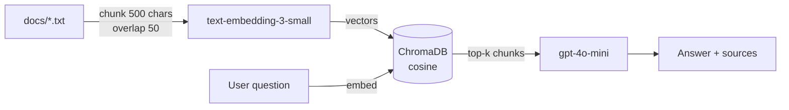

# Simple RAG Demo

A minimal Retrieval-Augmented Generation application built with FastAPI, ChromaDB, and the OpenAI API. Ask a question about your own text documents and get an answer grounded in them, along with the source chunks and their similarity scores.

The project is deliberately small — roughly 150 lines of Python across three files — so the whole retrieval pipeline stays readable end to end.

## How it works



Ingestion and querying both embed text with the same model, `text-embedding-3-small`. ChromaDB stores the vectors and performs nearest-neighbour search; it never generates embeddings itself, since they are passed in explicitly. The retrieved chunks are inserted into a prompt that instructs the model to answer only from the supplied context, and to say so when the context does not cover the question.

Each query costs two API calls: one embedding of the question, one chat completion.

## Requirements

- Python 3.9 or later
- An OpenAI API key with available credit

Verified on macOS with Python 3.9.12 and chromadb 1.5.9. All dependencies install from prebuilt wheels — no compiler toolchain required.

## Setup

```bash
python3 -m venv .venv
.venv/bin/pip install -r requirements.txt

cp .env.example .env
# then open .env and paste your key after OPENAI_API_KEY=
```

## Usage

Run the ingestion step first, then start the server:

```bash
.venv/bin/python ingest.py
.venv/bin/uvicorn api:app --reload
```

Open http://127.0.0.1:8000 and ask a question.

`ingest.py` reads every `.txt` file in `docs/` and prints how many chunks each one produced, followed by the total vector count. A total of `0` means no documents were found — check that `docs/` contains `.txt` files.

To add your own documents, drop them into `docs/` and run `ingest.py` again. It uses `upsert`, so re-running will not create duplicates.

### Order matters

Run `ingest.py` before starting the server the first time. Both modules call `get_or_create_collection`, and whichever runs first determines the collection's distance metric. Both now request cosine explicitly, so the order is no longer load-bearing, but ingesting first is still the sensible sequence — otherwise the server starts against an empty index and every answer will be "資料に記載がありません".

Both modules also resolve `./chroma_db` and `templates/` relative to the working directory, so run all commands from the project root.

## API

`POST /query`

```json
{ "query": "What is the storage limit?", "top_k": 4 }
```

Response:

```json
{
  "answer": "...",
  "sources": [
    { "text": "...", "source": "docs/sample.txt", "score": 0.393 }
  ]
}
```

`score` is cosine similarity in the range -1 to 1, derived as `1 - distance`. Higher is more similar. Sources come back in descending order of similarity.

## Project structure

```
.
├── api.py               FastAPI app: serves the UI and the /query endpoint
├── ingest.py            Chunks documents, embeds them, writes to ChromaDB
├── retriever.py         Vector search and answer generation
├── templates/
│   └── index.html       Single-page UI (Tailwind via CDN)
├── docs/
│   └── sample.txt       Sample document for trying the demo
├── requirements.txt
└── .env.example
```

`chroma_db/` is created on first ingest and is excluded from version control — it can always be rebuilt by re-running `ingest.py`.

## Tuning

| Setting | Location | Default |
| --- | --- | --- |
| Chunk size | `ingest.py` `CHUNK_SIZE` | 500 characters |
| Chunk overlap | `ingest.py` `OVERLAP` | 50 characters |
| Chunks retrieved | `top_k` in the request body | 4 |
| Embedding model | `ingest.py` / `retriever.py` | `text-embedding-3-small` |
| Chat model | `retriever.py` | `gpt-4o-mini` |

Changing the embedding model changes the vector dimensionality, which ChromaDB will reject against an existing collection. Delete `chroma_db/` and re-ingest after switching models. The embedding model must always match between ingestion and querying.

## Known limitations

- The UI renders chunk text with `innerHTML`, so a document containing `<` will break the source display. Switch to `textContent` before using it with real documents.
- `api.py` appends `...` to every source excerpt, including chunks shorter than the 200-character truncation point.
- `ingest.py` embeds all of a file's chunks in a single API call, which will hit request limits on very large documents.
- Chunks of 50 characters or fewer are dropped, so a file consisting only of short lines yields nothing to embed and causes the embedding call to fail on an empty input.
- The Tailwind CDN is loaded from the network; offline, the page still works but is unstyled.
